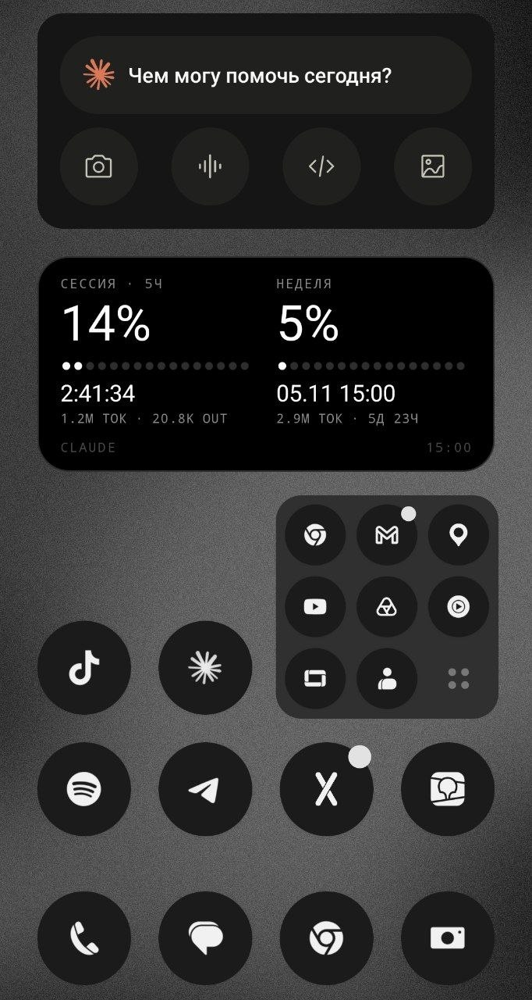

<div align="center">

**English** · [Русский](README.ru.md)

# ● Claude Usage Widget

**A Nothing-style Android widget that puts your Claude limits right on the home screen**

5-hour session · weekly limit · time until reset · Claude Code tokens


</div>

---

<div align="center">



<sub>Real widget on the home screen: 5-hour session on the left, weekly limit on the right. The widget UI is in Russian.</sub>

</div>

## ✦ Features

- **Both limits at a glance**: 5-hour session and weekly usage as dotted progress bars.
- **Live countdown** to the session reset. The launcher ticks the timer itself, so the app stays asleep and doesn't drain the battery.
- **Claude Code tokens** for the current window (total and output), counted from local logs.
- **Works away from home**: the phone reaches your computer over HTTPS through [Tailscale Funnel](https://tailscale.com/kb/1223/funnel). No ports opened on your LAN.
- **Offline-friendly**: without a connection the widget keeps the last data and shows a clear status.
- **Minimal**: zero third-party dependencies on the server (pure Python stdlib) and in the app (plain Android SDK). The release APK is about 26 KB.

## ⚙ How it works

```
 ┌─────────────┐   HTTPS + Bearer   ┌──────────────────┐        ┌──────────────────────────────┐
 │    Phone    │ ─────────────────▶ │ Tailscale Funnel │ ─────▶ │  127.0.0.1:8765              │
 │   (widget)  │                    │  *.ts.net        │        │  claude_usage_server.py      │
 └─────────────┘                    └──────────────────┘        └──────────────┬───────────────┘
                                                                               │
                                ┌──────────────────────────────────────────────┤
                                ▼                                              ▼
                 api.anthropic.com/api/oauth/usage              ~/.claude/projects/**/*.jsonl
                 usage %, reset times                           Claude Code tokens
                 (60 s cache, Claude Code OAuth token)          (read incrementally)
```

**The server** (`server/claude_usage_server.py`) runs on the computer where Claude Code is installed:

- reads the OAuth token from `~/.claude/.credentials.json` and asks Anthropic for the current limits, at most once a minute;
- counts tokens from Claude Code transcripts. The `*.jsonl` files are append-only, so after the first pass the server reads only new lines from the saved offset; duplicate streaming entries are dropped;
- if Anthropic is unreachable or the token has expired, returns the last known limits together with an error description;
- listens on `127.0.0.1` only and refuses to start without an access key. The key is compared in constant time and never written to logs.

**The app** (`android/`) is a widget plus a settings screen:

- refreshes every 30 minutes via `JobScheduler`, on tap, and exactly when a limit resets;
- survives phone reboots;
- caches the last server response and shows it while offline.

## 🚀 Installation

> [!TIP]
> **A detailed step-by-step guide from scratch is in [INSTALL.md](INSTALL.md).** It covers installing Claude Code, Tailscale and the Android SDK, putting the APK on the phone, and troubleshooting. Below is the short version for those who already have everything set up.

### Requirements

| Where | What |
|---|---|
| Computer | Linux with `systemd`, Python 3.8+, [Claude Code](https://claude.com/claude-code) signed in with a Claude subscription, [Tailscale](https://tailscale.com/download) |
| Phone | Android 8.0+ |
| Building the APK | Java (JRE) and the Android SDK; Gradle downloads JDK 21 by itself |

### 1. Server

Clone the repository into `~/development/claude-usage-widget`, which is the path the unit file expects. If you put the project elsewhere, edit `ExecStart` in `server/claude-usage-server.service`.

```bash
git clone https://github.com/mtvxlqq/claude-usage-widget.git ~/development/claude-usage-widget

# access key (created once, readable by the owner only)
[ -f ~/.config/claude-usage-server.env ] || \
  (umask 077; echo "CLAUDE_WIDGET_KEY=$(openssl rand -hex 16)" > ~/.config/claude-usage-server.env)

# autostart via systemd (user service)
mkdir -p ~/.config/systemd/user
cp ~/development/claude-usage-widget/server/claude-usage-server.service ~/.config/systemd/user/
systemctl --user daemon-reload
systemctl --user enable --now claude-usage-server

# expose over HTTPS
sudo tailscale funnel --bg 8765
```

From now on the server, Tailscale and Funnel start automatically when the computer boots.

> [!TIP]
> To start the service right after boot, without logging in, enable lingering:
> `loginctl enable-linger $USER`

Check it:

```bash
curl -H "Authorization: Bearer $(cut -d= -f2 ~/.config/claude-usage-server.env)" \
     https://<machine>.<tailnet>.ts.net/usage
```

`tailscale funnel status` shows your Funnel address.

### 2. App

```bash
cd android
./gradlew assembleRelease
```

The APK ends up in `android/app/build/outputs/apk/release/app-release.apk`. Install it on the phone, e.g. `adb install -r app-release.apk`.

> [!NOTE]
> The release build is signed with the debug key. That's fine for personal use but not for store publishing.
> The Android SDK path is set in `android/local.properties` (`sdk.dir=...`) or via `ANDROID_HOME`.

### 3. Setup

1. Add the **Claude Usage** widget to the home screen; the settings screen opens.
2. Enter the Funnel address (`https://<machine>.<tailnet>.ts.net`) and the key from `~/.config/claude-usage-server.env`.
3. Tap **«Сохранить и проверить»** (Save and check).
4. Tap **«Разрешить работу в фоне»** (Allow background work) so the system doesn't throttle refreshes.

## 🔎 Widget status

The bottom-right corner shows the result of the last refresh:

| Status | Meaning | What to do |
|---|---|---|
| `14:05` | time the limits were fetched | all good |
| `···` | refreshing | wait |
| `НЕТ СВЯЗИ · 14:05` | no connection: computer is off or no internet | data is shown as of that time |
| `ТОКЕН ИСТЁК · 14:05` | token expired: Claude Code hasn't run for a while | run `claude` on the computer |
| `НЕВЕРНЫЙ КЛЮЧ` | wrong key: app key doesn't match the server's | compare with `~/.config/claude-usage-server.env` |
| `НУЖНА НАСТРОЙКА` | setup needed: no server address | open the app and fill in the settings |
| `ОШИБКА СЕРВЕРА` | server error | details in the app under «Последняя ошибка виджета» (last widget error) |

Server logs:

```bash
journalctl --user -u claude-usage-server -f
```

## 📡 Server API

`GET /usage` with the `Authorization: Bearer <key>` header (or the `?key=<key>` parameter):

```json
{
  "session": { "percent": 42, "resets_at": 1761832800, "tokens": 1200000, "output_tokens": 38400 },
  "weekly":  { "percent": 17, "resets_at": 1762149600, "tokens": 8700000, "output_tokens": 251000 },
  "updated_at": 1761821100,
  "error": { "code": "auth", "message": "токен Claude Code истёк — запусти claude на ноутбуке" }
}
```

| Field | Description |
|---|---|
| `session`, `weekly` | limit window; `null` if the window hasn't started yet |
| `percent` | limit usage, percent |
| `resets_at` | reset time, Unix seconds |
| `tokens`, `output_tokens` | Claude Code tokens in the window (all / output only) |
| `updated_at` | when the limits were fetched from Anthropic |
| `error` | present only if the limits failed to refresh and the last known ones are returned |

Status codes: `403` wrong key, `503` limits have never been fetched successfully, `500` internal error.

Server environment variables: `CLAUDE_WIDGET_KEY` (required), `HOST` (default `127.0.0.1`), `PORT` (default `8765`).

## 📁 Project structure

```
claude-usage-widget/
├── server/
│   ├── claude_usage_server.py        # HTTP server: limits + token counting
│   └── claude-usage-server.service   # systemd --user unit
└── android/
    ├── app/src/main/
    │   ├── java/dev/mtvxlqq/claudewidget/
    │   │   ├── UsageWidget.java      # widget rendering, statuses
    │   │   ├── UsageClient.java      # server request, settings storage
    │   │   ├── RefreshJob.java       # background refreshes via JobScheduler
    │   │   └── SettingsActivity.java # settings screen
    │   └── res/                      # layouts, dotted bars, Doto font
    └── OFL-Doto.txt                  # font license
```

## ⚠️ Disclaimer

This is an unofficial project and is not affiliated with Anthropic. The server uses the undocumented `api/oauth/usage` endpoint, which may change or stop working without notice.

## 📜 License

The code is released under the [MIT License](LICENSE).

The **Doto** font © The Doto Project Authors is licensed under the [SIL Open Font License 1.1](android/OFL-Doto.txt). The APK includes only a subset of its glyphs.
